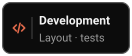

<h1 align="center">Prompt Polish: Claude Code mod</h1>

<p align="center">
  <b>A Claude Code mod that rewrites your prompt with prompt engineering before you send it,<br>
  using the official prompting guide for the session's model.</b>
</p>

<p align="center">
  <a href="README.md">한국어</a> · <b>English</b>
</p>

<p align="center">
  <a href=".claude-plugin/plugin.json"></a>
  <a href="#requirements"></a>
  <a href="https://github.com/jheroorehj/prompt-polish/stargazers"></a>
</p>

<p align="center">
  <a href="#install"><ruby></ruby></a>
  <a href="#why-it-exists"><ruby></ruby></a>
  <a href="#how-it-works"><ruby></ruby></a>
  <a href="#usage"><ruby></ruby></a>
  <a href="#commands"><ruby></ruby></a>
  <a href="#settings"><ruby></ruby></a>
  <br>
  <a href="#faq"><ruby></ruby></a>
  <a href="#development"><ruby></ruby></a>
  <a href="#references"><ruby></ruby></a>
  <a href="#feedback"><ruby></ruby></a>
  <a href="#license"><ruby></ruby></a>
  <a href="https://github.com/jheroorehj/prompt-polish"><ruby></ruby></a>
</p>

<p align="center">
  
  <br>
  <sub>The terminal pane: write a prompt → check the polish → <code>Apply Polish</code> → Enter to send</sub>
</p>

There are two ways to polish a prompt.

- **Enter with `AUTO ON`**: write a prompt and press Enter. Prompt Polish first rewrites it with a separate model call, then shows the result in Claude Code's question dialog and asks `Apply Polish`, `Keep Original` or `Retry Polish`. The prompt is sent the moment you choose, so there is no second Enter and no "Prompt blocked by a hook" row in the conversation.
- **The `Prompt Polish` button (or `/p_polish <prompt>`)**: the pane shows your original (`Original Prompt`) and the polish (`Polished Prompt`). `Apply Polish` replaces the contents of the prompt box with the polish, and you send it yourself with Enter.

The picture above shows the terminal pane where you check and apply a polish, which is the flow of the `Prompt Polish` button. `AUTO ON` changed after the picture was made: pressing Enter now asks about the result in a question dialog instead of the pane, and sends as soon as you choose. The picture below shows the Claude desktop app with `AUTO ON`.

<p align="center">
  
  <br>
  <sub>Desktop app, <code>AUTO ON</code>: Enter → <code>Polishing</code> → choose <code>Apply Polish</code> in the question → the polished text is sent. The app decides how the question dialog looks, so the picture is a sketch of it.</sub>
</p>

## Install

A mod is a Claude Code plugin with a hooks module, so you install it with the `/plugin` command like any other plugin.

### Install commands

Type these two lines inside Claude Code.

```
/plugin marketplace add jheroorehj/prompt-polish
/plugin install prompt-polish@prompt-polish
```

To install from a terminal, run:

```sh
claude plugin marketplace add jheroorehj/prompt-polish
claude plugin install prompt-polish@prompt-polish
```

After installing, open a **new session** and type `/p_polish` to open the pane.

<details>
<summary><b>Run it for one session without installing</b></summary>

<br>

```sh
git clone https://github.com/jheroorehj/prompt-polish
claude --plugin-dir ./prompt-polish
```

The mod is loaded only in a session started this way.

</details>

### Requirements

| Item | Description |
| --- | --- |
| Claude Code 2.1.287 or later | The version that supports mods. Check with `claude --version`. |
| Fullscreen terminal (recommended) | The pane docks beside the conversation and its buttons can be clicked. On a regular screen the pane is a summary above the prompt box and works by keyboard only. |
| Claude desktop app (Code tab) | Drawn with a screen made for the app. By default it is a **band** right above the prompt box; the `Placement` setting can use a **pane** beside the conversation instead. Layout and pictures are in [8. In the Claude desktop app](#8-in-the-claude-desktop-app). The pictures and tables in 1 to 7 are of the terminal; the buttons and behavior are the same. |
| VS Code extension · mobile app | Drawn with the same cell-based pane as the terminal. |

## Why it exists

Prompts to Claude Code tend to be written in the order they come to mind and sent as they are. Applying prompt engineering means opening a separate Claude, handing it the prompt and copying the answer back. Repeating that for every prompt is a chore, and the separate Claude does not know the project you are working in or the conversation so far.

Prompt Polish puts this step inside Claude Code, in the terminal and in the Claude desktop app, as a mod. Pressing Enter in the prompt box runs the polish, and the result is shown in a question dialog or in a pane on the same screen. The polish call is given the project's files and the agent's last answer.

Models also differ in how they like to be prompted. Prompt Polish reads the session's model and applies the guide for it; if the prompt is for another model, you can pick the guide yourself.

## How it works

| Item | Behavior |
| --- | --- |
| Check before sending | With `AUTO ON`, pressing Enter puts the prompt in the conversation, polishes it first, asks about the result in a question dialog, and sends the one you choose. The mod does not block the prompt: its hook waits and then lets the prompt through, so there is no second Enter. If the polish fails, finds nothing to change, or questions cannot be asked in the environment, the prompt is sent as written. `Stop`, or putting the question away, does not send it. A second Enter while a polish is running is not sent either. |
| Guide choice | Guides for Opus 5.5, Sonnet 5.5, GPT-6 Astra and GPT-5.6 are built in. A session model ID containing `sonnet` gets the Sonnet 5.5 guide, `gpt-6` or `astra` gets GPT-6 Astra, `gpt-5` gets GPT-5.6, and anything else gets the Opus 5.5 guide. |
| Applying a guide | Each guide has an "add" list and a "remove or change" list. The Opus 5.5 guide, for example, asks for explicit completion criteria and removes phrases like "think step by step". |
| What is kept | The prompt's intent, scope, language and tone are kept. File paths, code, commands, URLs, @mentions and quotations are left character for character. Requirements and files that are not in the original are not added. |

### The polish call

The polish is one model call, separate from the working session. It is a text-only call with no tools, and it does not continue any earlier call. The request and the response are not added to the working conversation, and the result is shown only in the pane or the question dialog. Only two things reach the working session: with the `Prompt Polish` button, the prompt box contents after `Apply Polish`; with `AUTO ON`, the text you pick in the question dialog, which is what gets sent.

The call is given these four things. The whole conversation history is not given.

| Given | Contents |
| --- | --- |
| Project files | The file list, `CLAUDE.md`, manifests, and the start of files whose names appear in the prompt. Details are in the table below. |
| Original prompt | The whole prompt from the prompt box, as the text to rewrite. |
| Last answer | The text of the agent's last answer in the working session. If it is longer than 4,000 characters, only the last 4,000 are given. It is for resolving words like "what you just said". |
| Model guide | The "add" and "remove or change" lists of the guide for the `Session Model`, sent as the system prompt together with the common editing rules. |

`Retry Polish` adds the result you just saw, so the model writes something different.

The mod reads the project files from disk itself and puts them in as text. The polish model does not open files, so only what is described below is given.

| Project file | How it is read |
| --- | --- |
| File list | From the project root, the paths of files tracked by `git ls-files` plus untracked files that are not ignored. Outside a git repository it walks the folder up to 3 levels deep (excluding `node_modules`, `dist` and similar, at most 2,000 files). With 150 files or fewer every path is written; above that only files near the root are written by name and the rest are counted per folder. |
| `CLAUDE.md` | The first 2,000 characters, if it is in the project root. |
| Manifests | Up to 2 files in the root that show the tech stack, such as `package.json`, `go.mod`, `pyproject.toml` or `Cargo.toml`, the first 1,500 characters of each. |
| Named files | Up to 3 files whose path or name appears in the original prompt or the last answer, the first 2,000 characters of each. If several files share a name, the path is needed to find one. |

> [!NOTE]
> `.env`, key and certificate files, files with `secret` or `credential` in the name, and binaries such as images and archives are not read. Only their names appear in the file list.

### When input is read again

To keep token use down, input is handled as follows.

| Action | Input handling |
| --- | --- |
| A polish (`Prompt Polish` button, Enter with `AUTO ON`, `/p_polish <prompt>`) | Reads the project files and the last answer anew and keeps what it read. |
| `Retry Polish` | Does not read the disk again; sends what was kept. Only the original prompt and the previous result are new. Only if you edited the prompt in the prompt box are the files it names looked up and read again. |
| `Apply Polish` | Discards what was kept. |
| `Keep Original`, `Stop`, a failed call, sending the prompt | Does not discard what was kept. The next polish replaces it with what it reads. |

The request is built from the least changing part to the most changing: the guide, the project (file list, `CLAUDE.md`, manifests), the named files and the last answer, then the original prompt. A prompt-cache mark is put on each of the first three parts. The project part is sorted so the text is the same every time while the files are unchanged.

### Guide sources

The Opus 5.5 and Sonnet 5.5 guides are rules written from the Anthropic documents listed in [References](#references), keeping the items that apply when editing a prompt. The documents are not fetched at run time; the rules are in `hooks/guides.ts`. The GPT-6 Astra and GPT-5.6 guides do not reflect source documents yet.

## Usage

[1. Open the pane](#1-open-the-pane) · [2. Polish and send a prompt](#2-polish-and-send-a-prompt) · [3. Polish again](#3-polish-again-retry-polish) · [4. Undo an apply](#4-undo-an-apply-undo-apply) · [5. `AUTO` and the guide](#5-auto-and-the-guide) · [6. Choosing models](#6-choosing-models) · [7. History and keys](#7-history-and-keys) · [8. In the Claude desktop app](#8-in-the-claude-desktop-app)

### 1. Open the pane

Type `/p_polish`. `/polish` is the same command. With the `Open on start` setting on (the default), the pane opens when a session starts. In the desktop app with `Placement` set to `band` (the default), no pane opens; the band is already above the prompt box.

<p align="center">
  
  <br>
  <sub>The pane at rest. From the top: the settings box, the <code>Prompt Polish</code> button, <code>Keys</code> · <code>History</code></sub>
</p>

| Where | Shown | Description |
| --- | --- | --- |
| Settings box, row 1, left | `Reference : Opus 5.5 Guide` | The guide in use. Click to unfold a description of the guide. |
| Settings box, row 1, right | `Ready` / `Polishing` / `Review` | The current state: at rest, polishing, or waiting for your answer on a result. |
| Settings box, row 2 | `AUTO ON` / `AUTO OFF` | Whether pressing Enter polishes first. |
| Settings box, row 2 | `Session Model : …` | The model the prompt is for. The guide is chosen from this. |
| Settings box, row 3 | `Polish Model : … (…)` | The model that polishes, and its effort. |
| Below the settings box | `Prompt Polish` | Polishes what is in the prompt box now. |
| Bottom | `Keys` · `History` | The key list and the record of work. Click to unfold upward. |

This table is for the terminal screen. The desktop app screen is described in [8](#8-in-the-claude-desktop-app).

### 2. Polish and send a prompt

**Enter with `AUTO ON`**

| Step | What to do | Result |
| :---: | --- | --- |
| 1 | Write a prompt in the prompt box and press <kbd>Enter</kbd> | The prompt goes into the conversation, and sending waits until the polish is done. |
| 2 | Wait (`Stop` to cancel) | The state becomes `Polishing`, with a spinner, elapsed time and `Polishing prompt`. |
| 3 | Choose in the question dialog | The polished text appears as the question. The state is `Review`, and the band and pane say `Waiting for your answer`. |
| 4 | `Apply Polish` / `Keep Original` / `Retry Polish` | Sent the moment you choose. Text typed under `Other` is sent as it is. |

| Choice | What it does |
| --- | --- |
| `Apply Polish` | Sends the polished prompt. The text the model receives and the conversation records is the polished text. |
| `Keep Original` | Sends the prompt as you wrote it. |
| `Retry Polish` | Polishes again, passing the result you just saw so the new one is composed differently, and asks again. |
| `Other` | Sends the text you typed. |

If you dismiss the question dialog, the prompt is not sent.

**The `Prompt Polish` button or `/p_polish <prompt>`**

| Step | What to do | Result |
| :---: | --- | --- |
| 1 | Write a prompt in the prompt box and press the `Prompt Polish` button | The polish starts. |
| 2 | Wait (`Stop` to cancel) | The settings box shows a spinner, elapsed time and `Polishing prompt`. |
| 3 | Check the result | `Original Prompt` and `Polished Prompt` boxes appear, each with its character count. |
| 4 | Choose `Apply Polish` / `Retry Polish` / `Keep Original` | See the button table below. |
| 5 | <kbd>Enter</kbd> | The prompt in the prompt box is sent. |

<p align="center">
  
  
  <br>
  <sub>Left: step 2, polishing · Right: step 3, checking the result</sub>
</p>

| Button | What it does |
| --- | --- |
| `Apply Polish` | Replaces the prompt box contents with the polish. |
| `Retry Polish` | Polishes again, passing the result you just saw so the new one is composed differently. |
| `Keep Original` | Discards the polish. If the prompt box is empty, the original is put back. |
| `Stop` | Cancels a polish in progress. Shown only while polishing. |

The two boxes are stacked when the pane is narrower than 110 columns and placed side by side from 110 columns.

In these cases `AUTO ON` sends at once, with no polish or question.

- Input that starts with `/`, `!` or `#`
- Input shorter than 20 characters
- A polish that comes out the same as the original (the `Already clear. No changes.` notice is shown)
- A model call that failed (the `Polish failed.` notice is shown)
- An environment where the question dialog cannot be used (the `A question cannot be asked here.` notice is shown)
- Prompts that you did not send from the prompt box (background task notices, messages from other sessions, scheduled runs)
- A prompt whose result you already checked with the `Prompt Polish` button: sending what is in the prompt box with Enter does not polish it again.

Closing the pane while a result is on show is the same as `Keep Original`. In the desktop app with the band, though, closing the side pane leaves the result on show in the band.

> [!NOTE]
> With `AUTO ON` the prompt goes into the conversation the moment you press Enter. The app and the terminal put a prompt in the conversation before they hand it to a mod, so a mod has no way to catch it earlier. Because the prompt is let through instead of blocked, a `Prompt blocked by a hook` row appears only when you stop it with `Stop` or put the question dialog away. The reason is in the [FAQ](#faq).

### 3. Polish again: `Retry Polish`

This polishes the same prompt again. The result you just saw is passed to the model so the structure and wording come out differently. The project files and the last answer are not read again; what the first polish read is used. The start of the request is the same as the previous call, so that part is read from the prompt cache. There is no limit on the count, and each one adds a `Retried` line to `History`.

<p align="center">
  
  <br>
  <sub>Pressing <code>Retry Polish</code> replaces the <code>Polished Prompt</code> with a new result</sub>
</p>

Results made by `Retry Polish` pile up as versions. With more than one version, `‹ 2 / 3 ›` (in the desktop app, `‹ Version 2 of 3 ›`) appears at the right end of the button row (in the desktop app, in the head of the band's stage and above the pane's result card), and `‹` and `›` page through the versions. `Apply Polish` applies the version on show, and `Retry Polish` polishes differently from the version on show. Up to the latest 10 versions are kept; a new `Prompt Polish`, an apply, or a send clears them. The picture above was made before this display existed, so it does not show it.

If the prompt box has text, the polish is made from **the text in the prompt box now**, not from the prompt you first polished. If you edit the prompt and then press `Retry Polish`, `Original Prompt` also changes to the edited text. In that case only the files named in the edited text are looked up and read again; the file list, `CLAUDE.md`, manifests and the last answer are what was read the first time.

<p align="center">
  
  <br>
  <sub>Adding a sentence to the prompt in the prompt box and then pressing <code>Retry Polish</code></sub>
</p>

### 4. Undo an apply: `Undo Apply`

After `Apply Polish`, an `Undo Apply` button appears next to the `Prompt Polish` button. Pressing it puts the prompt box back to what it was before the apply, and the button goes away. After you send the prompt the button is no longer shown.

<p align="center">
  
  <br>
  <sub>After <code>Apply Polish</code>, <code>Undo Apply</code> puts the prompt box back as it was</sub>
</p>

### 5. `AUTO` and the guide

<p align="center">
  
  
  <br>
  <sub>Left: switching <code>AUTO</code> · Right: pressing <code>Reference</code> to open the guide description</sub>
</p>

| Shown | What it does |
| --- | --- |
| `AUTO ON` | Pressing Enter polishes first, asks about the result in a question dialog, and sends the one you choose. |
| `AUTO OFF` | Pressing Enter sends at once. Press the `Prompt Polish` button only when you want a polish; the rest is the same as from step 3 of [2](#2-polish-and-send-a-prompt). |
| `Reference : …` | Click to unfold a summary of what the current guide adds and removes. Click again to close. |

In the terminal, switching `AUTO` shows a note under the buttons for 5 seconds that says what Enter does. In the desktop app's side pane, unfolding `Settings` shows the same explanation under the `AUTO` row; the band has no such explanation. The setting is saved and kept in the next session.

### 6. Choosing models

<p align="center">
  
  
  <br>
  <sub>Left: the <code>Session Model</code> list · Right: <code>Polish Model</code> and effort</sub>
</p>

**`Session Model`** is the model the prompt is for.

- The default is the session's model, detected, and its name ends in `(Detected)`.
- If you are writing a prompt for another model, pick it from the list. Choosing closes the list, and the guide name in `Reference` changes with it.
- Choosing a GPT model turns the pane's border and accent green.

**`Polish Model`** is the model that does the polishing.

- Pick a model in the left list. The one chosen is marked with `>` and `✓` and goes to the top of the list.
- Pick the effort on the right slider. Click a tick or the name under it (`low`, `medium`, `high`, `xhigh`, `max`).
- A choice takes effect at once and the box stays open. Press `done` to close it.

Both values are saved and kept in the next session.

In the desktop app, `Session`, `Polish` and `Effort` are each a select; the lists unfold as chips, and choosing one closes the list. If the list has more than 15 models, only the first 15 are shown as chips and the rest are chosen with `/p_polish model <name>`.

### 7. History and keys

<p align="center">
  
  <br>
  <sub><code>Keys</code> and <code>History</code> unfolded</sub>
</p>

**`History`** records `Polished`, `Retried`, `Applied`, `Kept` and `Failed` with the time. Folded, only the latest entry is shown beside it; unfolded, the latest 8 are shown.

**`Keys`** is the list of keys.

> [!IMPORTANT]
> **The keys work only while this list is unfolded.** Click the pane or press <kbd>ctrl</kbd>+<kbd>x</kbd> <kbd>tab</kbd> to give it focus, then use them.

| Key | Action | Key | Action |
| :---: | --- | :---: | --- |
| <kbd>p</kbd> | Prompt Polish | <kbd>a</kbd> | Switch AUTO |
| <kbd>y</kbd> | Apply Polish | <kbd>t</kbd> | Session Model list |
| <kbd>r</kbd> | Retry Polish | <kbd>m</kbd> | Polish Model box |
| <kbd>x</kbd> | Keep Original | <kbd>1</kbd>-<kbd>9</kbd> | Choose in an open list |
| <kbd>u</kbd> | Undo Apply | <kbd>l</kbd> | History |
| <kbd>b</kbd> | Older version | <kbd>n</kbd> | Newer version |
| <kbd>c</kbd> | Stop | <kbd>k</kbd> | Keys |
| <kbd>Tab</kbd> | Move to the next button | <kbd>Enter</kbd> | Press the button |

### 8. In the Claude desktop app

The desktop app (Code tab) draws the same features with a screen made for the app. Every action is a click; each control is a rounded box of the same height, and a click on the words, the icon, the arrow or the room around them all press it. There is no key list (`Keys`).

The **band** is the screen when `Placement` is `band` (the default), and it sits right above the prompt box. The app gives the band about 11 lines and cuts off anything beyond that, with no scroll bar. So the band is built from the four places below to stay inside that, and each place stays where it is when the state changes.

| Place | Contents |
| --- | --- |
| Head | The name and a chevron (▾) at the left, `AUTO` and the state at the right. Pressing the name minimizes the band. `Ready` is a dot that does not move, `Polishing` is a turning ring, and `Review` is a slowly moving dot. |
| Settings | The `Session`, `Polish` and `Effort` selects. While a polish runs, the values in use are shown in the same place instead of the selects. |
| Stage | The loading mark while polishing; in review, the first two lines of the polish and the version (`‹ Version 2 of 3 ›`). While `AUTO ON` waits for your answer in the question dialog, `Waiting for your answer` is shown. |
| Bottom | The left is what to do now (`Prompt Polish` and `Undo Apply`; in review, `Apply Polish`, `Retry Polish` and `Keep Original`; while running, `Stop`). The right is `Full view` (in review only) and `History`. |

<p align="center">
  
  <br>
  <sub>The band's three states. From the top: at rest · polishing · reviewing (when polished with the <code>Prompt Polish</code> button)</sub>
</p>

With `AUTO ON`, pressing Enter makes the band `Polishing` while it polishes, and then `Review`, with `Waiting for your answer` on the stage. The result is asked about in the question dialog, not in the band, and at that point there is nothing to press at the left of the bottom line. The app decides how the question dialog looks.

While a pick list is open, the list takes the place of the stage and the bottom line, and choosing one closes it.

<p align="center">
  
  <br>
  <sub>Pick lists unfold as chips. Top: <code>Polish</code> · Bottom: <code>Effort</code></sub>
</p>

Pressing the name (`Prompt Polish ▾`) minimizes the band. A minimized band leaves nothing above the prompt box; a small chip appears at the right of the line under it. The chip's words and dot show the state (`Prompt Polish` and a green dot at rest, `Polishing…` and an orange dot while a polish runs, `Review` and a blue dot in review), and pressing the chip opens the band again. `AUTO ON` keeps working while it is minimized, and the state you leave it in is kept for the next session.

A long polish cannot be read in full in the band, so you read it in the **side pane**. When a review starts the pane opens by itself and shows the original and the whole polish, version paging and the apply, retry and keep buttons; it closes when you apply, keep or send the prompt. `Full view` opens the pane again, and `History` opens it with the record unfolded.

The **side pane** is all there is when `Placement` is `pane`. Cards are stacked from top to bottom.

<p align="center">
  
  <br>
  <sub>The side pane in review. With the band, <code>Full view</code> opens the same pane.</sub>
</p>

| Card | Contents |
| --- | --- |
| Progress | The name and state, and under them the four steps `Draft`, `Polish`, `Review` and `Apply`. At rest, the `Prompt Polish` button; while polishing, the loading mark and `Stop`. |
| Result | Shown only in review. The whole polish, the original unfolded with `Show original`, and `Apply Polish`, `Retry Polish` and `Keep Original`. |
| `Settings` | Folded, it shows the current settings in one line. Unfolded, it has `AUTO`, `Session model`, `Polish model`, `Effort` (five steps from `low` to `max`) and the guide. |
| `History` | Folded, it shows the latest entry beside it; unfolded, the latest 8. |

If buttons do not respond, see the click-catcher item in the [FAQ](#faq).

### 9. Carry a session over

For picking up what you were doing after a new session or a `/clear`. Each part is switched on or chosen by each person for themself, and nothing is attached on its own.

- **Session trail**: turn it on with the `TRAIL` button or `/p_polish carry on`. It starts off. When on, it keeps for each project the last 8 prompts, the end of the last answer, the names of the files changed, the to-do list and `git status`, only in the plugin's own store in this computer's Claude folder. No model is called. API keys, tokens, passwords, email addresses, phone numbers, ID-number shapes and home-folder paths are masked before saving, but a secret of a shape it does not know can be missed. Nothing is written to the project or this repository.
- **Handoff document**: `/p_polish carry now what the next session is for` runs the installed `handoff` skill (Matt Pocock, MIT) as one turn of this session and keeps the document it wrote, masked the same way. It uses this session's tokens. With no skill installed, it only shows the install command; it does not write one itself.
- **Picking up**: at the first prompt of a new session, if a handoff document or a trail under 7 days old is kept, it asks which to add. If you add one, it goes beside that prompt once, as notes marked as data and not instructions. A resumed session (`--resume`) is not asked. Where the question cannot be shown, `carry use` adds it to your next prompt and `carry skip` passes it by.
- **At 70% context** it asks once per session whether to write a handoff document. It only asks; it never writes one on its own.
- **Choosing an earlier session**: open `Pick up an earlier session` in the pane (the band has an `Earlier sessions` button) to see this project's sessions of the last 24 hours, and `Up to 7 days` if what you want is not there. Each row shows the title and, under it, when it was, how many files it changed and the start of its last prompt. Click a session to open it and see its last prompt in full, then press `Hand over to this session` to give it to the session you are in. Afterwards a `✓ Handed over …` line stays in the card, and a new session starts without it. The card is hidden while you are reviewing a polish. What is handed over enters the conversation as a hidden note the model reads with your next prompt; no model is called. The list is read from the session files Claude Code keeps on this computer, so sessions from before you turned TRAIL on appear too. The files are read only when you open the list, only their start and end, and only a few prompts and file names are taken from them, masked, and not stored. A session with a handoff document lets you pick `Notes` or `Handoff document`. By command: `/p_polish carry sessions [week]` lists and `/p_polish carry take <number> [handoff]` hands one over.
- **Setup**: `/p_polish carry setup` shows whether the free tools (handoff, session-report, planning-with-files) are installed, and the commands to install them. While planning-with-files is installed, the session trail is not offered.
- **Delete**: `/p_polish carry clear` deletes this project's, and `carry clear all` every project's.

## Commands

`/p_polish` and `/polish` are the same command.

| Input | What it does |
| --- | --- |
| `/p_polish` | Opens the pane. In the desktop app, opens the band again if it was minimized. |
| `/p_polish <prompt>` | Polishes the prompt you typed and shows it in the pane. |
| `/p_polish auto` | Turns `AUTO` on or off. |
| `/p_polish target` | Prints the current `Session Model` and the names you can choose. |
| `/p_polish target <name>` | Changes `Session Model`. One of `auto`, `opus-5.5`, `sonnet-5.5`, `gpt-6-astra`, `gpt-5.6`. |
| `/p_polish model` | Prints the current `Polish Model` and the list. |
| `/p_polish model <name>` | Changes `Polish Model`. A model name that is not in the list can also be typed. |
| `/p_polish effort <level>` | Changes the effort. One of `low`, `medium`, `high`, `xhigh`, `max`. |
| `/p_polish usage` | Shows the tokens the polish calls used (input, cache write, cache read, output), how much of the input the cache served, how often a polish was retried and the gaps between calls. Only numbers are kept, never the text; `/p_polish usage clear` erases them. Once 10 calls are recorded, a cache mark that is not read back is switched off from these numbers, and the marks now on are shown with them. |
| `/p_polish carry` | Carrying a session over: `on`, `off`, `now [what the next session is for]`, `setup`, `sessions [week]`, `take <number> [handoff]`, `show [handoff]`, `use [trail\|handoff]`, `skip`, `clear [all]`. See [Carry a session over](#9-carry-a-session-over). |
| `/p_polish plain` | Turns the click catchers over the buttons off or on in the desktop app. Use it only when buttons do not respond. (See the [FAQ](#faq).) |
| `/p_polish close` | Closes the pane. In the desktop app, minimizes the band to one chip in the line under the prompt box. |

## Settings

Change them in `/config`. A value chosen in the pane takes precedence.

| Item | Default | Description |
| --- | --- | --- |
| Polish Model | `sonnet` | The model that polishes. Type a short name like `sonnet` or a full model name. |
| Effort | `low` | How hard the model reasons while polishing. Higher is slower. `/config` offers `low`, `medium` and `high`. |
| Open on start | On | Opens the pane when a session starts. In the desktop app with `Placement` set to `band`, no pane opens and the band is already shown. |
| Placement | `band` | Where the Claude desktop app shows Prompt Polish. `band` is the band right above the prompt box, `pane` is a pane beside the conversation. The terminal and other apps always use the pane. |

## FAQ

<details>
<summary><b>Clicking the buttons with the mouse does nothing</b></summary>

<br>

Mouse clicks in the terminal work only on a **fullscreen terminal**. On a regular screen the pane shows `No mouse clicks on this screen (fullscreen only)`. In that case press <kbd>ctrl</kbd>+<kbd>x</kbd> <kbd>tab</kbd> to give the pane focus, then use <kbd>Tab</kbd> and <kbd>Enter</kbd>.

</details>

<details>
<summary><b>In the desktop app I sometimes had to press a button twice</b></summary>

<br>

That comes from how the app and the engine work. The app gets a new number (a handle) for a button each time it redraws the pane, and the engine drops a click that arrives with an old number. Pressing a button in the pane while you were in the prompt box made that click give the pane focus and redraw it, so that very click was dropped.

Since 0.4.0 each button has a click catcher (`hooks/hit.tsx`) over it. The catcher is passed by name, not by number, so a click is not dropped when the pane is redrawn. If a catcher breaks, the pane is drawn again with the buttons alone. If buttons still do not respond at all, turn the catchers off with `/p_polish plain`. Running it again turns them back on.

</details>

<details>
<summary><b>With AUTO ON, my message goes into the conversation first when I press Enter</b></summary>

<br>

The app and the terminal put a prompt in the conversation when you press Enter and only then hand it to the mod. A mod can block the prompt, let it through after changing it, or let it through as it is; it cannot catch it earlier. If a mod blocks a prompt, the app writes a `Prompt blocked by a hook` row in the conversation, however the reason is worded.

Since 0.8.0, `AUTO ON` does not block the prompt. It polishes inside the hook, asks in the question dialog, and lets the prompt through as the text you chose. So there is no blocked row and no second Enter. The row is left only when you stop with `Stop`, when you put the question dialog away, and when you press Enter again while a polish is running. To avoid the message going into the conversation first, set `AUTO OFF` and polish in the prompt box with the `Prompt Polish` button.

</details>

<details>
<summary><b>Typing /p_polish shows "isn't a command here" but the pane opens</b></summary>

<br>

It is only a notice from the app, and the command runs as usual. In a new session that has not started yet, the app's command list does not include the commands a mod registers, so it shows the notice. Once the session has started they are on the list and it does not appear. In the desktop app with the band, you rarely need this command.

</details>

<details>
<summary><b>The side pane opens by itself in review</b></summary>

<br>

The app gives the band about 11 lines, so a long polish cannot be read in full there. The band shows the first two lines of the result and you read all of it in the pane. Applying or keeping closes the pane, and even if you close the pane yourself you can still apply or keep from the band.

</details>

<details>
<summary><b>Does polishing cost extra?</b></summary>

<br>

Each polish is one model call, and each `Retry Polish` is one more. Every call includes the project files and the last answer, within the per-item limits. To use less, set `Polish Model` to a smaller model and the effort to `low`. `/p_polish usage` shows what they actually used. Once 10 calls are recorded, a part that is written to the cache and never read back (a write costs 25% more than plain input) loses its mark, and gets it back when it starts being read again.

</details>

<details>
<summary><b>What is sent to the polish model?</b></summary>

<br>

The project files (the file list, `CLAUDE.md`, manifests, and the start of files named in the prompt), the original prompt, the agent's last answer, and the model's guide. Earlier conversation and tool calls are not sent. The per-item limits and the files that are not read are in [The polish call](#the-polish-call).

</details>

<details>
<summary><b>I ran a polish but no result screen appeared</b></summary>

<br>

Short questions and prompts that are already clear are meant to be left alone. If the result is the same as the original, no result screen is shown, only the `Already clear. No changes.` notice, and if the model call fails the `Polish failed.` notice is shown. With `AUTO ON`, in both cases the prompt is sent as you wrote it, with no question.

</details>

<details>
<summary><b>No progress is shown</b></summary>

<br>

A model call gives no progress. So instead of a progress bar, a line moves left and right to show work is going on, and the elapsed time is next to the spinner. In the desktop app, the turning ring beside the state and the dotted line of the loading mark do the same. A call is stopped after 60 seconds.

</details>

<details>
<summary><b>The Effort slider is under the model list</b></summary>

<br>

The pane is too narrow for the model list and the slider to fit on one line. Widen the pane and the slider appears to the right of the list.

</details>

## Development

Run these inside the repository folder.

```sh
claude --plugin-dir .     # load straight from the folder
claude plugin validate .
claude plugin test .
```

| File | Contents |
| --- | --- |
| `.claude-plugin/plugin.json` | The plugin manifest: name, version, `/config` settings |
| `.claude-plugin/marketplace.json` | Marketplace listing |
| `hooks/hooks.json` | Which modules to load |
| `hooks/register.tsx` | Receives events, hands them to `core.ts`, and picks the side that draws the pane (terminal or desktop app) |
| `hooks/core.ts` | The logic every screen shares: state, what each button does, polishing, reading project files, command registration, and polishing and asking before Enter sends |
| `hooks/view.ts` | The definitions of the values the pane receives (`View`) and the actions its buttons call (`Act`) |
| `hooks/terminal.tsx` | The pane of the terminal (and VS Code and mobile) |
| `hooks/kit.tsx` | The desktop app's one set of controls: primary and secondary buttons, select field, switch, segments, disclosure row, step display |
| `hooks/desktop.tsx` | The Claude desktop app's side pane (a stack of cards) |
| `hooks/band.tsx` | The Claude desktop app's band above the prompt box (a fixed height within about 11 lines; the whole result is read in the pane) |
| `hooks/polish.ts` | Building the polish request and handling the response |
| `hooks/project.ts` | Summarizing the file list, finding files by the names in a text, extracting the last answer |
| `hooks/guides.ts` | The per-model guides, their sources, and session model detection |
| `hooks/spinner.tsx` · `bar.tsx` · `pulse.tsx` | The spinner, the progress line and the state mark animations |
| `hooks/icons.ts` | The desktop app's icons, switch, step display and progress line |
| `hooks/hit.tsx` | The click catcher laid over a button in the desktop app |
| `LICENSE` | MIT License |
| `README.md` | The Korean README |
| `THIRD_PARTY_NOTICES.md` | License notices for the icons taken from other projects |
| `hooks/polish.test.ts` | Tests |
| `types/index.d.ts` | State type definitions |

## References

| Source | What was used |
| --- | --- |
| [Getting the most out of Opus 5.5 in Claude and Claude Code](https://claude.dev/blog/getting-the-most-out-of-opus-5-5/) | The Opus 5.5 guide |
| [Prompting Claude Opus 5.5](https://platform.claude.com/docs/en/build-with-claude/prompt-engineering/prompting-claude-opus-5-5) | The Opus 5.5 guide |
| [Building with Claude Sonnet 5.5](https://claude.dev/blog/building-with-claude-sonnet-5-5/) | The Sonnet 5.5 guide |
| [Prompting Claude Sonnet 5.5](https://platform.claude.com/docs/en/build-with-claude/prompt-engineering/prompting-claude-sonnet-5-5) | The Sonnet 5.5 guide |
| [Mods reference](https://code.claude.com/docs/en/plugins/mods/reference) | Building the mod: the files of a hooks module, events, the mods API methods, where and with what elements the pane is drawn, and the limits. |
| [affaan-m/ECC](https://github.com/affaan-m/ECC) | How project files are passed. The `prompt-optimizer` skill's project detection (finding the tech stack from `CLAUDE.md` and manifests), the token-light code map of `/update-codemaps` (mostly file paths instead of all the code), and the `iterative-retrieval` skill's way of putting in only the relevant files. |
| [assistant-ui](https://github.com/assistant-ui/assistant-ui) | The layout of the button row and of version paging. Like `ActionBar`, the button row sits under the result and is hidden while running; like `BranchPicker`, the versions made by `Retry Polish` are paged through as `‹ 2 / 3 ›`. The card layout of the desktop app screen was also drawn from it. No code was taken. |
| [GitHub Primer](https://primer.style/), [shadcn/ui](https://ui.shadcn.com/), [Apple Human Interface Guidelines](https://developer.apple.com/design/human-interface-guidelines/) | The controls of the desktop app screen: the hierarchy of primary and secondary buttons, the settings row with the name at the left and the value at the right, and the switch and the segmented control. No code was taken. |
| [Lucide](https://github.com/lucide-icons/lucide) | The icons beside the buttons and the toggles' chevrons on the desktop app screen (ISC; some derive from Feather, MIT). The icons in `docs/images/desktop-*.svg` are the same ones. The notices are in [`THIRD_PARTY_NOTICES.md`](THIRD_PARTY_NOTICES.md). |
| [Matt Pocock's `handoff` skill](https://github.com/mattpocock/skills) (MIT) | `/p_polish carry now` runs the installed skill to get a handoff document. Only called; none of its code or text is copied. |
| [Anthropic's `session-report`](https://github.com/anthropics/claude-plugins-official/tree/main/plugins/session-report) (Apache-2.0) | A report of where a session's tokens went. `/p_polish carry setup` only points to it. |
| [planning-with-files](https://github.com/OthmanAdi/planning-with-files) (MIT) | A plugin that recovers a session from plan files. Only pointed to; while it is installed, Prompt Polish does not offer its own session trail. |
| claude-mem, remember, Basic Memory, the MCP memory server | Looked at and not used. The reasons are in [`THIRD_PARTY_NOTICES.md`](THIRD_PARTY_NOTICES.md). |

## Feedback

If you notice something odd or have a question, please leave feedback or a question as an [issue](https://github.com/jheroorehj/prompt-polish/issues). Thank you.

## License

[MIT License](LICENSE). The licenses of the icons taken from other projects, and the notices for outside tools that are only called and not included, are in [`THIRD_PARTY_NOTICES.md`](THIRD_PARTY_NOTICES.md).
