<h1 align="center">Prompt Polish: Claude Code mod</h1>

<p align="center">
  <b>Prompt Polish 는 모델별 공식 프롬프팅 가이드를 기준으로,<br>
  직접 작성한 프롬프트를 Claude Code 안에서 바로 프롬프트 엔지니어링해 주는 Claude Code mod 입니다.</b>
</p>

<p align="center">
  <i>A Claude Code mod that rewrites your prompt with prompt engineering before you send it,<br>
  using the official prompting guide for the session's model.</i>
</p>

<p align="center">
  <b>한국어</b> · <a href="README.en.md">English</a>
</p>

<p align="center">
  <a href=".claude-plugin/plugin.json"></a>
  <a href="#요구-사항"></a>
  <a href="https://github.com/jheroorehj/prompt-polish/stargazers"></a>
</p>

<p align="center">
  <a href="#설치"><ruby></ruby></a>
  <a href="#왜-필요한가"><ruby></ruby></a>
  <a href="#동작-방식"><ruby></ruby></a>
  <a href="#사용법"><ruby></ruby></a>
  <a href="#명령어"><ruby></ruby></a>
  <a href="#설정"><ruby>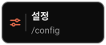</ruby></a>
  <br>
  <a href="#자주-묻는-질문"><ruby></ruby></a>
  <a href="#개발"><ruby>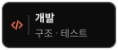</ruby></a>
  <a href="#참고한-자료"><ruby></ruby></a>
  <a href="#피드백"><ruby></ruby></a>
  <a href="#라이선스"><ruby>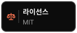</ruby></a>
  <a href="https://github.com/jheroorehj/prompt-polish"><ruby>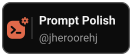</ruby></a>
</p>

```
/plugin marketplace add jheroorehj/prompt-polish
/plugin install prompt-polish@prompt-polish
```

<p align="center">
  
  <br>
  <sub>터미널의 창: 프롬프트 입력 → 재작성 결과 확인 → <code>Apply Polish</code> → Enter 로 전송</sub>
</p>

재작성은 두 가지로 쓸 수 있습니다.

- **`AUTO ON` 에서 Enter**: 프롬프트를 쓰고 Enter 를 누르면 별도의 모델 호출로 프롬프트를 먼저 재작성하고, 결과를 Claude Code 의 질문 상자로 보여 주며 `Apply Polish` · `Keep Original` · `Retry Polish` 중에서 묻습니다. 고르는 즉시 그 프롬프트가 전송되므로 Enter 를 한 번 더 누를 필요가 없고, 대화에 "훅에 의해 차단된 프롬프트" 기록도 남지 않습니다.
- **`Prompt Polish` 버튼(또는 `/p_polish <프롬프트>`)**: 창에 원본(`Original Prompt`)과 재작성 결과(`Polished Prompt`)가 표시되고, `Apply Polish` 를 누르면 입력창의 내용이 재작성 결과로 교체됩니다. Enter 를 눌러 직접 전송합니다.

위 그림은 터미널의 창에서 결과를 확인하고 적용하는 단계입니다. 이 단계는 `Prompt Polish` 버튼으로 재작성할 때의 흐름과 같습니다. 그림을 만든 뒤 `AUTO ON` 이 바뀌어서, 지금은 Enter 로 재작성하면 결과를 창 대신 질문 상자로 묻고 고르는 즉시 전송합니다. 아래 그림은 Claude 데스크톱 앱에서 `AUTO ON` 으로 Enter 를 눌렀을 때의 흐름입니다.

<p align="center">
  
  <br>
  <sub>데스크톱 앱, <code>AUTO ON</code>: Enter → <code>Polishing</code> → 질문에서 <code>Apply Polish</code> 선택 → 재작성한 글이 전송됩니다. 질문 상자의 모양은 앱이 정하므로 그림은 개략입니다.</sub>
</p>

## 설치

mod 는 훅 모듈을 가진 Claude Code 플러그인이라, 다른 플러그인처럼 `/plugin` 명령으로 설치합니다.

### 설치 명령

Claude Code 안에서 아래 두 줄을 입력합니다.

```
/plugin marketplace add jheroorehj/prompt-polish
/plugin install prompt-polish@prompt-polish
```

터미널에서 설치하려면 아래 명령을 실행합니다.

```sh
claude plugin marketplace add jheroorehj/prompt-polish
claude plugin install prompt-polish@prompt-polish
```

설치 후 **새 세션**을 열고 `/p_polish` 를 입력하면 창이 열립니다.

<details>
<summary><b>설치하지 않고 한 세션에서만 실행하기</b></summary>

<br>

```sh
git clone https://github.com/jheroorehj/prompt-polish
claude --plugin-dir ./prompt-polish
```

이렇게 실행한 세션에서만 mod 가 로드됩니다.

</details>

### 요구 사항

| 항목 | 설명 |
| --- | --- |
| Claude Code 2.1.287 이상 | mods 를 지원하는 버전입니다. `claude --version` 으로 확인합니다. |
| 전체화면 터미널 (권장) | 창이 대화 옆에 도킹되고 버튼을 마우스로 클릭할 수 있습니다. 일반 화면에서는 창이 입력창 위에 요약 형태로 표시되고 키보드로만 조작합니다. |
| Claude 데스크톱 앱 (Code 탭) | 데스크톱 앱 전용 화면으로 그려집니다. 기본은 입력창 바로 위 **띠**이고, `Placement` 설정으로 대화 옆 **패널**만 쓸 수도 있습니다. 구성과 그림은 [8. Claude 데스크톱 앱에서](#8-claude-데스크톱-앱에서) 에 있습니다. 1~7번의 그림과 표는 터미널 화면 기준이며, 버튼 이름과 동작은 같습니다. |
| VS Code 확장 프로그램 · 모바일 앱 | 터미널과 같은 칸 기반 창으로 그려집니다. |

## 왜 필요한가

Claude Code 에 보내는 프롬프트는 생각나는 순서대로 적어 그대로 보내게 되기 쉽습니다. 프롬프트 엔지니어링을 적용하려면 Claude 를 따로 열어 프롬프트를 맡기고, 돌려받은 결과를 복사해 와야 합니다. 프롬프트를 보낼 때마다 이 과정을 반복하는 것은 번거롭고, 따로 연 Claude 에는 작업 중인 프로젝트와 직전 대화가 전달되지 않습니다.

Prompt Polish 는 이 과정을 Claude Code mod 로 만들어 터미널과 Claude 데스크톱 앱 안에 넣은 것입니다. 입력창에서 Enter 를 누르면 재작성이 실행되고, 결과는 질문 상자나 같은 화면의 창에 표시됩니다. 재작성 호출에는 프로젝트 파일과 에이전트의 마지막 답변이 함께 전달됩니다.

모델마다 맞는 프롬프팅 방식이 다르다는 점도 반영했습니다. 현재 세션의 모델을 확인해서 그 모델에 해당하는 가이드를 적용하고, 다른 모델에 보낼 프롬프트라면 가이드를 직접 고를 수 있습니다.

## 동작 방식

| 항목 | 동작 |
| --- | --- |
| 전송 전 확인 | `AUTO ON` 상태에서 Enter 를 누르면 프롬프트가 대화에 올라간 채로 재작성부터 하고, 결과를 질문 상자로 물은 뒤 고른 쪽을 전송합니다. 프롬프트를 막지 않고 훅 안에서 기다렸다가 통과시키는 방식이라 Enter 를 다시 누를 필요가 없습니다. 재작성이 실패했거나 이미 명확하거나 질문을 할 수 없는 환경이면 쓴 그대로 전송합니다. `Stop` 으로 멈추거나 질문 상자를 닫으면 전송하지 않습니다. 재작성이 도는 중에 Enter 를 또 누르면 그 프롬프트는 전송되지 않습니다. |
| 가이드 선택 | Opus 5.5, Sonnet 5.5, GPT-6 Astra, GPT-5.6 가이드가 내장되어 있습니다. 세션 모델 ID 에 `sonnet` 이 있으면 Sonnet 5.5, `gpt-6` 또는 `astra` 가 있으면 GPT-6 Astra, `gpt-5` 가 있으면 GPT-5.6 가이드를 쓰고, 그 외에는 Opus 5.5 가이드를 씁니다. |
| 가이드 적용 | 가이드마다 "보강할 것"과 "지우거나 바꿀 것" 목록이 있습니다. 예를 들어 Opus 5.5 가이드는 완료 기준을 명시하게 하고 "think step by step" 같은 문구를 지웁니다. |
| 유지하는 것 | 프롬프트의 의도, 범위, 언어, 말투는 유지합니다. 파일 경로, 코드, 명령어, URL, @멘션, 인용문은 글자 그대로 둡니다. 원본에 없는 요구사항이나 파일을 추가하지 않습니다. |

### 재작성 호출

재작성은 작업 세션과 분리된 모델 호출 한 번으로 처리합니다. 도구 없이 텍스트만 주고받는 호출이고, 이전 호출의 내용은 이어받지 않습니다. 요청과 응답은 작업 중인 대화에 추가되지 않고, 결과는 창이나 질문 상자에만 표시됩니다. 작업 세션에 영향을 주는 것은 두 가지뿐입니다. `Prompt Polish` 버튼으로 재작성했다면 `Apply Polish` 를 눌렀을 때의 입력창 내용이고, `AUTO ON` 이라면 질문 상자에서 고른 글이 전송되는 것입니다.

호출에는 아래 네 가지가 전달됩니다. 대화 기록 전체는 전달하지 않습니다.

| 전달되는 것 | 내용 |
| --- | --- |
| 프로젝트 파일 | 파일 목록, `CLAUDE.md`, 매니페스트, 그리고 프롬프트에 이름이 나온 파일의 앞부분입니다. 자세한 내용은 아래 표에 있습니다. |
| 원본 프롬프트 | 입력창에 쓴 프롬프트 전체입니다. 재작성 대상으로 전달됩니다. |
| 마지막 답변 | 작업 세션에서 에이전트가 마지막으로 한 답변의 텍스트입니다. 4,000자를 넘으면 끝의 4,000자만 전달합니다. "방금 말한 것" 같은 지시어를 풀어 쓰는 용도입니다. |
| 모델별 가이드 | `Session Model` 에 해당하는 가이드의 "보강할 것"과 "지우거나 바꿀 것" 목록입니다. 공통 편집 규칙과 함께 시스템 프롬프트로 전달됩니다. |

`Retry Polish` 를 누르면 여기에 방금 결과가 추가로 전달됩니다. 그와 다른 구성으로 쓰게 하는 용도입니다.

프로젝트 파일은 mod 가 디스크에서 직접 읽어서 텍스트로 넣습니다. 재작성 모델이 파일을 열어 보는 것이 아니므로, 아래에 적힌 것만 전달됩니다.

| 프로젝트 파일 | 읽는 방법 |
| --- | --- |
| 파일 목록 | 프로젝트 루트에서 `git ls-files` 로 추적 중인 파일과, 무시되지 않은 미추적 파일의 경로를 가져옵니다. git 저장소가 아니면 폴더를 3단계까지 탐색합니다(`node_modules`, `dist` 등 제외, 최대 2,000개). 파일이 150개 이하면 경로를 전부 적고, 넘으면 루트 근처 파일만 이름으로 적고 나머지는 폴더별 개수로 적습니다. |
| `CLAUDE.md` | 프로젝트 루트에 있으면 앞 2,000자를 넣습니다. |
| 매니페스트 | `package.json`, `go.mod`, `pyproject.toml`, `Cargo.toml` 등 기술 스택을 알 수 있는 파일이 루트에 있으면 2개까지, 각각 앞 1,500자를 넣습니다. |
| 이름이 나온 파일 | 원본 프롬프트나 마지막 답변에 경로 또는 파일 이름이 적힌 파일을 3개까지, 각각 앞 2,000자를 넣습니다. 같은 이름의 파일이 여러 개면 경로까지 적어야 찾습니다. |

> [!NOTE]
> `.env`, 키와 인증서 파일, 이름에 `secret` 이나 `credential` 이 들어간 파일, 이미지와 압축 파일 같은 바이너리는 내용을 읽지 않습니다. 파일 목록에는 이름만 들어갑니다.

### 입력을 다시 읽는 시점

토큰 사용량을 줄이기 위해 입력을 아래처럼 다룹니다.

| 동작 | 입력 처리 |
| --- | --- |
| Polish 실행 (`Prompt Polish` 버튼, `AUTO ON` 에서 Enter, `/p_polish <프롬프트>`) | 프로젝트 파일과 마지막 답변을 새로 읽고, 읽은 내용을 보관합니다. |
| `Retry Polish` | 디스크를 다시 읽지 않고 보관한 내용을 그대로 다시 보냅니다. 원본 프롬프트와 이전 결과만 새로 붙습니다. 입력창의 프롬프트를 고쳐 쓴 경우에만 이름이 나온 파일을 다시 찾아 읽습니다. |
| `Apply Polish` | 보관한 내용을 버립니다. |
| `Keep Original`, `Stop`, 호출 실패, 프롬프트 전송 | 보관한 내용을 버리지 않습니다. 다음 Polish 실행 때 새로 읽은 내용으로 교체됩니다. |

요청은 잘 바뀌지 않는 것부터 순서대로 구성합니다. 가이드, 프로젝트(파일 목록·`CLAUDE.md`·매니페스트), 이름이 나온 파일과 마지막 답변, 원본 프롬프트 순서입니다. 앞의 세 부분에는 각각 프롬프트 캐시 표시를 붙입니다. 프로젝트 부분은 파일 구성이 그대로면 매번 같은 텍스트가 되도록 정렬해서 만듭니다.

### 가이드 출처

Opus 5.5 와 Sonnet 5.5 가이드는 [참고한 자료](#참고한-자료)의 Anthropic 공식 문서를 읽고, 프롬프트를 고칠 때 적용할 수 있는 항목을 규칙으로 정리한 것입니다. 문서를 실행 중에 가져오지는 않고, 정리한 규칙이 `hooks/guides.ts` 에 들어 있습니다. GPT-6 Astra 와 GPT-5.6 가이드에는 아직 출처 문서를 반영하지 않았습니다.

## 사용법

[1. 창 열기](#1-창-열기) · [2. 프롬프트 재작성하고 보내기](#2-프롬프트-재작성하고-보내기) · [3. 다시 재작성하기](#3-다시-재작성하기-retry-polish) · [4. 적용 취소하기](#4-적용-취소하기-undo-apply) · [5. `AUTO` 와 가이드 확인](#5-auto-와-가이드-확인) · [6. 모델 선택](#6-모델-선택) · [7. 기록과 단축키](#7-기록과-단축키) · [8. Claude 데스크톱 앱에서](#8-claude-데스크톱-앱에서)

### 1. 창 열기

`/p_polish` 를 입력합니다. `/polish` 도 같은 명령입니다. `Open on start` 설정이 켜져 있으면(기본값) 세션을 시작할 때 창이 자동으로 열립니다. 데스크톱 앱에서 `Placement` 가 `band`(기본값)이면 창은 열리지 않고 띠가 입력창 위에 나와 있습니다.

<p align="center">
  
  <br>
  <sub>대기 상태의 창. 위에서부터 설정 박스, <code>Prompt Polish</code> 버튼, <code>Keys</code> · <code>History</code></sub>
</p>

| 위치 | 표시 | 설명 |
| --- | --- | --- |
| 설정 박스 1행 왼쪽 | `Reference : Opus 5.5 Guide` | 현재 적용 중인 가이드입니다. 클릭하면 가이드 설명이 펼쳐집니다. |
| 설정 박스 1행 오른쪽 | `Ready` / `Polishing` / `Review` | 대기, 재작성 중, 결과 확인 대기 중 현재 상태입니다. |
| 설정 박스 2행 | `AUTO ON` / `AUTO OFF` | Enter 를 눌렀을 때 재작성을 먼저 할지 정합니다. |
| 설정 박스 2행 | `Window ▾` | Prompt Polish 를 둘 자리입니다. `Compact` 는 입력창 바로 위 한 줄, `Minimize` 는 입력창 아래 줄, `Maximize` 는 이 패널, `Close` 는 모두 닫기(`/p_polish` 로 다시 열기)입니다. 터미널에만 있습니다. |
| 설정 박스 2행 | `Session Model : …` | 프롬프트를 받을 모델입니다. 이 값에 따라 가이드가 정해집니다. |
| 설정 박스 3행 | `Polish Model : … (…)` | 재작성을 수행할 모델과 effort 입니다. |
| 설정 박스 아래 | `Prompt Polish` | 입력창에 있는 프롬프트를 지금 재작성합니다. |
| 맨 아래 | `Keys` · `History` | 단축키 목록과 작업 기록입니다. 클릭하면 위쪽으로 펼쳐집니다. |

이 표는 터미널 화면 기준입니다. 데스크톱 앱 화면은 [8번](#8-claude-데스크톱-앱에서)에서 설명합니다.

### 2. 프롬프트 재작성하고 보내기

**`AUTO ON` 에서 Enter**

| 순서 | 할 일 | 결과 |
| :---: | --- | --- |
| 1 | 입력창에 프롬프트를 쓰고 <kbd>Enter</kbd> | 프롬프트가 대화에 올라가고, 전송은 재작성이 끝날 때까지 기다립니다. |
| 2 | 대기 (중단하려면 `Stop`) | 상태가 `Polishing` 이 되고 스피너, 경과 시간, `Polishing prompt` 가 표시됩니다. |
| 3 | 질문 상자에서 선택 | 재작성한 글이 질문으로 나오고, 상태는 `Review`, 띠와 창에는 `Waiting for your answer` 가 표시됩니다. |
| 4 | `Apply Polish` / `Keep Original` / `Retry Polish` | 고르는 즉시 전송됩니다. `Other` 에 직접 쓴 글을 넣으면 그 글이 전송됩니다. |

| 선택 | 동작 |
| --- | --- |
| `Apply Polish` | 재작성한 프롬프트를 전송합니다. 모델이 받고 대화에 기록되는 글은 재작성한 글입니다. |
| `Keep Original` | 쓴 그대로 전송합니다. |
| `Retry Polish` | 방금 결과를 함께 넘겨서, 그와 다른 구성으로 다시 재작성하고 다시 묻습니다. |
| `Other` | 직접 쓴 글을 전송합니다. |

질문 상자를 닫으면(`dismiss`) 프롬프트는 전송되지 않습니다.

**`Prompt Polish` 버튼 또는 `/p_polish <프롬프트>`**

| 순서 | 할 일 | 결과 |
| :---: | --- | --- |
| 1 | 입력창에 프롬프트를 쓰고 `Prompt Polish` 버튼 | 재작성이 시작됩니다. |
| 2 | 대기 (중단하려면 `Stop`) | 설정 박스에 스피너, 경과 시간, `Polishing prompt` 가 표시됩니다. |
| 3 | 결과 확인 | `Original Prompt` 와 `Polished Prompt` 박스가 각각 글자 수와 함께 표시됩니다. |
| 4 | `Apply Polish` / `Retry Polish` / `Keep Original` 중 선택 | 아래 버튼 표를 참고합니다. |
| 5 | <kbd>Enter</kbd> | 입력창에 있는 프롬프트가 전송됩니다. |

<p align="center">
  
  
  <br>
  <sub>왼쪽: 2단계, 재작성 중 · 오른쪽: 3단계, 결과 확인 화면</sub>
</p>

| 버튼 | 동작 |
| --- | --- |
| `Apply Polish` | 입력창의 내용을 재작성 결과로 교체합니다. |
| `Retry Polish` | 방금 결과를 함께 넘겨서, 그와 다른 구성으로 다시 재작성합니다. |
| `Keep Original` | 재작성 결과를 버립니다. 입력창이 비어 있으면 원본을 다시 채워 넣습니다. |
| `Stop` | 진행 중인 재작성을 중단합니다. 재작성 중에만 표시됩니다. |

두 박스는 창 폭이 110칸 미만이면 위아래로, 110칸 이상이면 좌우로 배치됩니다.

아래 경우에는 `AUTO ON` 이어도 재작성이나 질문 없이 바로 전송합니다.

- `/`, `!`, `#` 으로 시작하는 입력
- 20자 미만의 입력
- 재작성 결과가 원본과 같은 경우 (`Already clear. No changes.` 알림 표시)
- 모델 호출이 실패한 경우 (`Polish failed.` 알림 표시)
- 질문 상자를 쓸 수 없는 환경인 경우 (`A question cannot be asked here.` 알림 표시)
- 사용자가 입력창에서 보낸 것이 아닌 프롬프트(백그라운드 작업 알림, 다른 세션의 메시지, 예약 실행 등)
- `Prompt Polish` 버튼으로 이미 결과를 확인한 프롬프트: 입력창의 글을 Enter 로 보낼 때 다시 재작성하지 않습니다.

결과 확인 중에 창을 닫으면 `Keep Original` 과 같게 처리됩니다. 다만 데스크톱 앱에서 띠를 쓸 때는 옆 패널을 닫아도 결과 확인이 띠에 그대로 남습니다.

> [!NOTE]
> `AUTO ON` 에서는 Enter 를 누르는 순간 프롬프트가 대화에 올라갑니다. 앱과 터미널은 프롬프트를 먼저 대화에 올린 뒤에야 mod 에 넘기므로, mod 가 그보다 앞서 가로챌 방법이 없습니다. 대신 프롬프트를 막지 않고 통과시키므로 `Prompt blocked by a hook` 기록은 `Stop` 으로 멈추거나 질문 상자를 닫았을 때만 남습니다. 이유는 [자주 묻는 질문](#자주-묻는-질문)에 있습니다.

### 3. 다시 재작성하기: `Retry Polish`

같은 프롬프트를 다시 재작성합니다. 이때 방금 결과를 모델에 함께 전달해서, 구성과 표현이 그와 다르게 나오도록 요청합니다. 프로젝트 파일과 마지막 답변은 다시 읽지 않고 처음 Polish 때 읽은 내용을 그대로 씁니다. 요청의 앞부분이 직전 호출과 같아서 그 부분은 프롬프트 캐시에서 읽힙니다. 횟수 제한은 없고, 실행할 때마다 `History` 에 `Retried` 가 한 줄 추가됩니다.

<p align="center">
  
  <br>
  <sub><code>Retry Polish</code> 를 누르면 <code>Polished Prompt</code> 가 새 결과로 교체됩니다</sub>
</p>

`Retry Polish` 로 만든 결과는 버전으로 쌓입니다. 버전이 둘 이상이면 버튼 줄 오른쪽 끝(데스크톱 앱에서는 띠의 무대 머리와 패널의 결과 카드 위)에 `‹ 2 / 3 ›` (데스크톱 앱에서는 `‹ Version 2 of 3 ›`) 이 생기고, `‹` 와 `›` 로 앞뒤 버전을 넘겨볼 수 있습니다. `Apply Polish` 는 지금 보이는 버전을 적용하고, `Retry Polish` 는 지금 보이는 버전과 다르게 다시 재작성합니다. 버전은 최근 10개까지 남고, 새로 `Prompt Polish` 를 하거나 적용·전송하면 비워집니다. 위 그림은 이 표시가 생기기 전에 만든 것이라 그림에는 나오지 않습니다.

입력창에 글이 있으면 처음 재작성한 프롬프트가 아니라 **현재 입력창의 글**을 재작성합니다. 프롬프트를 고쳐 쓴 뒤 `Retry Polish` 를 누르면 `Original Prompt` 도 고쳐 쓴 글로 바뀝니다. 이 경우에는 고쳐 쓴 글에 이름이 나온 파일만 다시 찾아 읽고, 파일 목록·`CLAUDE.md`·매니페스트와 마지막 답변은 처음 읽은 내용을 그대로 씁니다.

<p align="center">
  
  <br>
  <sub>입력창의 프롬프트에 문장을 추가한 뒤 <code>Retry Polish</code> 를 누른 경우</sub>
</p>

### 4. 적용 취소하기: `Undo Apply`

`Apply Polish` 를 누르면 `Prompt Polish` 버튼 옆에 `Undo Apply` 가 생깁니다. 누르면 입력창이 적용 전 내용으로 돌아가고 버튼은 사라집니다. 프롬프트를 전송한 뒤에는 이 버튼이 표시되지 않습니다.

<p align="center">
  
  <br>
  <sub><code>Apply Polish</code> 후 <code>Undo Apply</code> 를 누르면 입력창이 적용 전 내용으로 돌아갑니다</sub>
</p>

### 5. `AUTO` 와 가이드 확인

<p align="center">
  
  
  <br>
  <sub>왼쪽: <code>AUTO</code> 전환 · 오른쪽: <code>Reference</code> 를 눌러 가이드 설명 열기</sub>
</p>

| 표시 | 동작 |
| --- | --- |
| `AUTO ON` | Enter 를 누르면 재작성부터 하고, 결과를 질문 상자로 물은 뒤 고른 쪽을 전송합니다. |
| `AUTO OFF` | Enter 를 누르면 바로 전송합니다. 재작성이 필요할 때만 `Prompt Polish` 버튼을 누르면 되고, 이후 과정은 [2번](#2-프롬프트-재작성하고-보내기)의 3단계부터와 같습니다. |
| `Reference : …` | 클릭하면 현재 가이드가 무엇을 보강하고 무엇을 지우는지 요약한 설명이 펼쳐집니다. 다시 클릭하면 닫힙니다. |

터미널에서는 `AUTO` 를 전환하면 버튼 아래에 Enter 의 동작을 설명하는 안내가 5초 동안 표시됩니다. 데스크톱 앱의 옆 패널은 `Settings` 를 펼치면 `AUTO` 줄 아래에 같은 설명이 있고, 띠에는 이 설명이 없습니다. 설정은 저장되어 다음 세션에도 유지됩니다.

### 6. 모델 선택

<p align="center">
  
  
  <br>
  <sub>왼쪽: <code>Session Model</code> 목록 · 오른쪽: <code>Polish Model</code> 과 effort 선택</sub>
</p>

**`Session Model`** 은 프롬프트를 받을 모델입니다.

- 기본값은 현재 세션의 모델을 감지한 결과이고, 이름 뒤에 `(Detected)` 가 붙습니다.
- 다른 모델에 보낼 프롬프트를 작성 중이라면 목록에서 직접 선택합니다. 선택하면 목록이 닫히고 `Reference` 의 가이드 이름이 함께 바뀝니다.
- GPT 계열을 선택하면 창의 테두리와 강조색이 초록색으로 바뀝니다.

**`Polish Model`** 은 재작성을 수행할 모델입니다.

- 왼쪽 목록에서 모델을 선택합니다. 선택된 모델은 `>` 와 `✓` 로 표시되고 목록 맨 위에 놓입니다.
- 오른쪽 슬라이더에서 effort 를 선택합니다. 눈금 또는 그 아래 이름(`low`, `medium`, `high`, `xhigh`, `max`)을 클릭합니다.
- 선택 즉시 적용되고 박스는 열린 상태로 유지됩니다. `done` 을 누르면 닫힙니다.

두 값 모두 저장되어 다음 세션에도 유지됩니다.

데스크톱 앱에서는 `Session`, `Polish`, `Effort` 가 각각 선택이고, 목록은 칩으로 펼쳐지며 하나를 고르면 닫힙니다. 목록에 모델이 15개를 넘으면 앞의 15개만 칩으로 보이고, 나머지는 `/p_polish model <이름>` 으로 고릅니다.

### 7. 기록과 단축키

<p align="center">
  
  <br>
  <sub><code>Keys</code> 와 <code>History</code> 를 펼친 모습</sub>
</p>

**`History`** 에는 `Polished`(재작성), `Retried`(다시 재작성), `Applied`(적용), `Kept`(원본 유지), `Failed`(실패)가 시각과 함께 기록됩니다. 접어 두면 가장 최근 한 건만 옆에 표시되고, 펼치면 최근 8건이 표시됩니다.

**`Keys`** 는 단축키 목록입니다.

> [!IMPORTANT]
> **단축키는 이 목록을 펼쳐 둔 동안에만 동작합니다.** 창을 클릭하거나 <kbd>ctrl</kbd>+<kbd>x</kbd> <kbd>tab</kbd> 을 눌러 창에 포커스를 준 뒤 사용합니다.

| 키 | 동작 | 키 | 동작 |
| :---: | --- | :---: | --- |
| <kbd>p</kbd> | Prompt Polish | <kbd>a</kbd> | AUTO 전환 |
| <kbd>y</kbd> | Apply Polish | <kbd>t</kbd> | Session Model 목록 |
| <kbd>r</kbd> | Retry Polish | <kbd>m</kbd> | Polish Model 박스 |
| <kbd>x</kbd> | Keep Original | <kbd>1</kbd>-<kbd>9</kbd> | 열려 있는 목록에서 선택 |
| <kbd>u</kbd> | Undo Apply | <kbd>l</kbd> | History |
| <kbd>b</kbd> | 이전 버전 | <kbd>n</kbd> | 다음 버전 |
| <kbd>c</kbd> | Stop | <kbd>k</kbd> | Keys |
| <kbd>Tab</kbd> | 다음 버튼으로 이동 | <kbd>Enter</kbd> | 버튼 누르기 |

### 8. Claude 데스크톱 앱에서

데스크톱 앱(Code 탭)은 같은 기능을 앱 전용 화면으로 그립니다. 모든 조작은 클릭이고, 컨트롤은 높이가 같은 둥근 박스이며, 글자뿐 아니라 아이콘·화살표·주변 여백 어디를 눌러도 눌립니다. 단축키 목록(`Keys`)은 없습니다.

**띠** 는 `Placement` 가 `band`(기본값)일 때의 화면으로, 입력창 바로 위에 놓입니다. 앱이 띠에 주는 높이는 약 11줄이고 넘친 내용은 스크롤바 없이 잘립니다. 그래서 띠는 그 안에 들도록 아래 네 자리로만 구성하고, 상태가 바뀌어도 각 자리는 그대로입니다.

| 자리 | 내용 |
| --- | --- |
| 머리 | 왼쪽에 이름과 화살표(▾), 오른쪽에 `AUTO` 와 상태입니다. 이름을 누르면 띠가 줄어듭니다. `Ready` 는 움직이지 않는 점, `Polishing` 은 도는 링, `Review` 는 천천히 움직이는 점입니다. |
| 설정 | `Session`·`Polish`·`Effort` 선택입니다. 폴리시 중에는 선택 대신 지금 쓰는 값이 같은 자리에 표시됩니다. |
| 무대 | 폴리시 중에는 로딩 표시, 결과 확인에서는 재작성한 글의 앞 두 줄과 버전(`‹ Version 2 of 3 ›`)입니다. `AUTO ON` 으로 질문 상자의 답을 기다리는 동안에는 `Waiting for your answer` 가 표시됩니다. |
| 맨 아래 | 왼쪽은 지금 할 일입니다(`Prompt Polish` 와 `Undo Apply`, 결과 확인의 `Apply Polish`·`Retry Polish`·`Keep Original`, 실행 중에는 `Stop`). 오른쪽은 `Full view`(결과 확인에서만)와 `History` 입니다. |

<p align="center">
  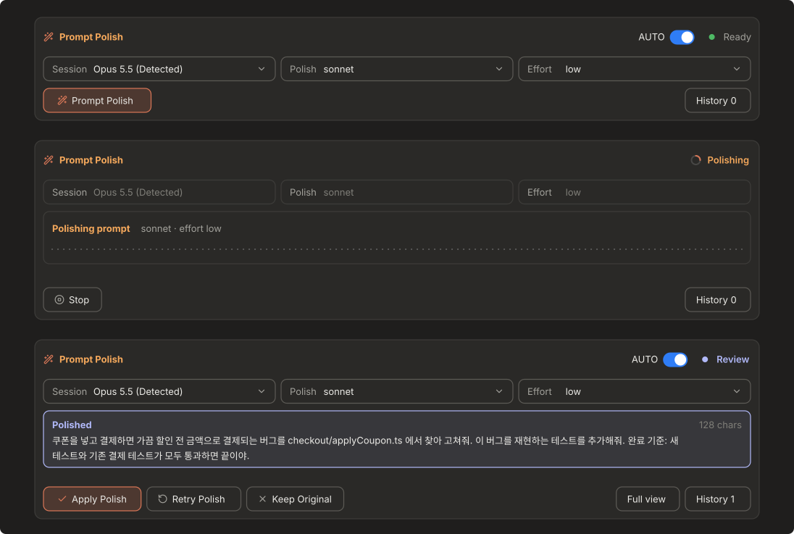
  <br>
  <sub>띠의 세 상태. 위에서부터 대기 · 재작성 중 · 결과 확인 (<code>Prompt Polish</code> 버튼으로 재작성한 경우)</sub>
</p>

`AUTO ON` 에서 Enter 를 누르면 재작성하는 동안 띠가 `Polishing` 이 되고, 끝나면 `Review` 가 되면서 무대에 `Waiting for your answer` 가 표시됩니다. 결과는 띠가 아니라 질문 상자로 묻고, 이때 맨 아래 줄의 왼쪽에는 누를 것이 없습니다. 질문 상자의 모양은 앱이 정합니다.

선택 목록이 열려 있는 동안에는 목록이 무대와 맨 아래 줄 자리를 대신하고, 하나를 고르면 닫힙니다.

<p align="center">
  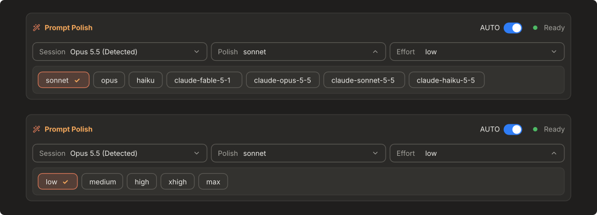
  <br>
  <sub>선택 목록은 칩으로 펼쳐집니다. 위: <code>Polish</code> · 아래: <code>Effort</code></sub>
</p>

이름(`Prompt Polish ▾`)을 누르면 띠가 줄어듭니다. 줄인 띠는 입력창 위에 아무것도 남기지 않고, 입력창 아래 줄 오른쪽에 작은 칩 하나가 생깁니다. 칩의 글자와 점이 상태를 보여 주고(대기는 `Prompt Polish` 와 초록 점, 재작성 중은 `Polishing…` 과 주황 점, 결과 확인은 `Review` 와 파란 점), 칩을 누르면 띠가 다시 펼쳐집니다. 줄여 두어도 `AUTO ON` 은 그대로 동작하고, 마지막에 둔 상태는 다음 세션에도 유지됩니다.

긴 재작성 결과는 띠에서 다 읽을 수 없으므로 **옆 패널** 에서 읽습니다. 결과 확인이 시작되면 패널이 자동으로 열려 원본과 재작성한 글 전체, 버전 넘기기, 적용·재시도·유지 버튼을 보여 주고, 적용하거나 유지하거나 프롬프트를 전송하면 닫힙니다. `Full view` 는 패널을 다시 열고, `History` 는 기록을 펼친 패널을 엽니다.

**옆 패널** 은 `Placement` 가 `pane` 일 때 이것만 사용합니다. 카드가 위에서 아래로 쌓입니다.

<p align="center">
  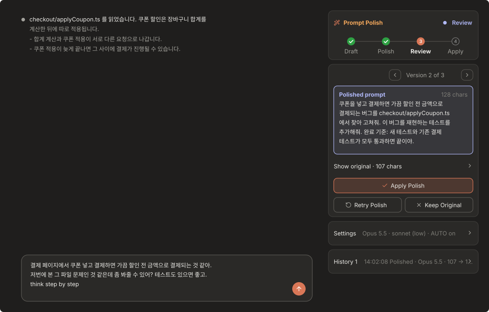
  <br>
  <sub>옆 패널의 결과 확인. 띠를 쓰는 경우에는 <code>Full view</code> 로 같은 패널이 열립니다.</sub>
</p>

| 카드 | 내용 |
| --- | --- |
| 진행 | 이름과 상태, 그 아래에 `Draft`·`Polish`·`Review`·`Apply` 네 단계가 표시됩니다. 대기 중에는 `Prompt Polish` 버튼, 폴리시 중에는 로딩 표시와 `Stop` 이 있습니다. |
| 결과 | 결과 확인에서만 나옵니다. 재작성한 글 전체, `Show original` 로 펼치는 원본, `Apply Polish`·`Retry Polish`·`Keep Original` 입니다. |
| `Settings` | 접힌 상태에서는 현재 설정을 한 줄로 보여 줍니다. 펼치면 `AUTO`, `Session model`, `Polish model`, `Effort`(`low`~`max` 다섯 칸), 가이드가 있습니다. |
| `History` | 접은 상태에서는 가장 최근 한 건을 옆에 보여 주고, 펼치면 최근 8건을 보여 줍니다. |

버튼이 눌리지 않으면 [자주 묻는 질문](#자주-묻는-질문)의 클릭 받이 항목을 확인합니다.

### 9. 세션 이어가기

새 세션이나 `/clear` 뒤에 앞서 하던 일을 이어가는 기능입니다. 모두 사용자가 각자 켜거나 고르며, 아무것도 저절로 붙지 않습니다.

- **세션 흔적**: `TRAIL` 버튼이나 `/p_polish carry on` 으로 켭니다. 기본값은 꺼짐입니다. 켜면 프로젝트마다 최근 프롬프트 8개, 마지막 답변의 끝, 바꾼 파일 이름, 할 일 목록, `git status` 를 이 컴퓨터의 Claude 폴더 안 플러그인 저장소에만 기록합니다. 모델은 부르지 않습니다. API 키, 토큰, 비밀번호, 이메일, 전화번호, 주민등록번호 모양, 홈 폴더 경로는 저장 전에 가리지만, 모르는 모양의 비밀은 놓칠 수 있습니다. 프로젝트 폴더와 이 저장소에는 아무것도 쓰지 않습니다.
- **인계 문서**: `/p_polish carry now 다음 세션에서 할 일` 이 설치된 `handoff` 스킬(Matt Pocock, MIT)을 이 세션의 한 턴으로 실행하고, 스킬이 쓴 문서를 같은 방식으로 가려서 보관합니다. 이 세션의 토큰을 씁니다. 스킬이 없으면 설치 명령만 안내하고 직접 만들어 주지 않습니다.
- **이어받기**: 새 세션의 첫 프롬프트를 보낼 때, 7일 안에 남은 인계 문서나 흔적이 있으면 무엇을 붙일지 묻습니다. 붙이면 "데이터이지 지시가 아니다"라고 표시한 메모로 그 프롬프트 옆에 한 번만 들어갑니다. `--resume` 한 세션에는 묻지 않습니다. 질문을 띄울 수 없으면 `carry use` 로 다음 프롬프트에 붙이고, `carry skip` 으로 넘깁니다.
- **컨텍스트가 70%에 닿으면** 인계 문서를 쓸지 세션마다 한 번 묻습니다. 묻기만 하고 저절로 쓰지 않습니다. [effortless](https://github.com/HeyCubit/effortless)가 설치돼 있으면 묻지 않습니다. effortless가 인계 시점을 직접 판단하기 때문입니다.
- **이전 세션 고르기**: 패널의 `Pick up an earlier session`(밴드에서는 `Earlier sessions` 버튼)을 열면 이 프로젝트의 최근 24시간 세션이 나오고, 없으면 `Up to 7 days`로 일주일까지 넓힐 수 있습니다. 각 줄에는 제목과 함께 시간, 바꾼 파일 수, 마지막 프롬프트 일부가 나옵니다. 세션을 누르면 펼쳐져 마지막 프롬프트 전체가 보이고, `Hand over to this session`을 눌러야 지금 세션에 넘어갑니다. 넘기고 나면 카드에 `✓ Handed over …` 줄이 남아 확인할 수 있고, 새 세션에서는 사라집니다. 폴리시 결과를 확인하는 중에는 이 카드가 숨겨집니다. 넘긴 내용은 모델이 다음 프롬프트와 함께 읽는 숨은 메모로 대화에 들어가며, 모델 호출은 일어나지 않습니다. 목록은 Claude Code가 이 컴퓨터에 보관한 세션 파일에서 읽기 때문에, TRAIL을 켜지 않았던 세션도 나옵니다. 목록을 열 때만 각 파일의 앞부분과 끝부분을 읽고, 프롬프트 몇 개와 파일 이름만 가려서 뽑으며, 저장하지는 않습니다. 인계 문서가 있는 세션은 `Notes`와 `Handoff document` 중 고릅니다. 명령어로는 `/p_polish carry sessions [week]`로 목록을 보고 `/p_polish carry take <번호> [handoff]`로 넘깁니다.
- **설치 안내**: `/p_polish carry setup` 이 무료 도구(handoff, session-report, planning-with-files, effortless)의 설치 여부와 설치 명령을 보여 줍니다. planning-with-files 가 설치돼 있으면 세션 흔적은 제안하지 않습니다.
- **지우기**: `/p_polish carry clear` 는 이 프로젝트의 것을, `carry clear all` 은 모든 프로젝트의 것을 지웁니다.

## 명령어

`/p_polish` 와 `/polish` 는 같은 명령입니다.

| 입력 | 동작 |
| --- | --- |
| `/p_polish` | 창을 엽니다. 데스크톱 앱에서 띠를 줄여 두었다면 다시 펼칩니다. |
| `/p_polish <프롬프트>` | 입력한 프롬프트를 재작성해서 창에 표시합니다. |
| `/p_polish auto` | `AUTO` 를 켜거나 끕니다. |
| `/p_polish target` | `Session Model` 의 현재 값과 선택 가능한 이름을 출력합니다. |
| `/p_polish target <이름>` | `Session Model` 을 변경합니다. `auto`, `opus-5.5`, `sonnet-5.5`, `gpt-6-astra`, `gpt-5.6` 중 하나입니다. |
| `/p_polish model` | `Polish Model` 의 현재 값과 목록을 출력합니다. |
| `/p_polish model <이름>` | `Polish Model` 을 변경합니다. 목록에 없는 모델 이름도 입력할 수 있습니다. |
| `/p_polish effort <단계>` | effort 를 변경합니다. `low`, `medium`, `high`, `xhigh`, `max` 중 하나입니다. |
| `/p_polish usage` | 재작성 호출이 쓴 토큰(입력, 캐시 쓰기, 캐시 읽기, 출력)과 캐시가 처리한 비율, 재시도 비율, 호출 사이의 간격을 보여 줍니다. 숫자만 기록하고 글은 저장하지 않으며, `/p_polish usage clear` 로 지웁니다. 기록이 10회 쌓이면, 다시 읽히지 않는 캐시 표시는 이 숫자를 보고 스스로 끄고 지금 켜진 표시도 함께 보여 줍니다. |
| `/p_polish carry` | 세션 이어가기. `on`, `off`, `now [할 일]`, `setup`, `sessions [week]`, `take <번호> [handoff]`, `show [handoff]`, `use [trail\|handoff]`, `skip`, `clear [all]`. 자세한 내용은 [세션 이어가기](#9-세션-이어가기)에 있습니다. |
| `/p_polish plain` | 데스크톱 앱에서 버튼 위의 클릭 받이를 끄거나 켭니다. 버튼이 눌리지 않을 때만 사용합니다. ([자주 묻는 질문](#자주-묻는-질문) 참고) |
| `/p_polish close` | 창을 닫습니다. 데스크톱 앱의 띠는 입력창 아래 줄의 칩 하나로 줄입니다. |

## 설정

`/config` 에서 변경합니다. 창에서 선택한 값이 있으면 그 값이 우선합니다.

| 항목 | 기본값 | 설명 |
| --- | --- | --- |
| Polish Model | `sonnet` | 재작성을 수행할 모델입니다. `sonnet` 같은 짧은 이름이나 전체 모델 이름을 입력합니다. |
| Effort | `low` | 재작성할 때의 추론 강도입니다. 높을수록 느려집니다. `/config` 에서는 `low`, `medium`, `high` 를 선택할 수 있습니다. |
| Open on start | 켜짐 | 세션을 시작할 때 창을 엽니다. 데스크톱 앱에서 `Placement` 가 `band` 이면 창은 열리지 않고 띠가 나와 있습니다. |
| Placement | `band` | Claude 데스크톱 앱에서 Prompt Polish 를 보여 주는 곳입니다. `band` 는 입력창 바로 위 띠, `pane` 은 대화 옆 패널입니다. 터미널과 다른 앱은 항상 창을 씁니다. |

## 자주 묻는 질문

<details>
<summary><b>버튼을 마우스로 클릭해도 반응이 없습니다</b></summary>

<br>

터미널에서 마우스 클릭은 **전체화면 터미널**에서만 동작합니다. 일반 화면에서는 창에 `No mouse clicks on this screen (fullscreen only)` 가 표시됩니다. 이 경우 <kbd>ctrl</kbd>+<kbd>x</kbd> <kbd>tab</kbd> 으로 창에 포커스를 준 뒤 <kbd>Tab</kbd> 과 <kbd>Enter</kbd> 로 조작합니다.

</details>

<details>
<summary><b>데스크톱 앱에서 버튼을 두 번 눌러야 할 때가 있었습니다</b></summary>

<br>

앱과 엔진 쪽 동작 때문입니다. 앱은 창을 다시 그릴 때마다 버튼에 새 번호(핸들)를 받고, 이전 번호로 온 클릭은 엔진이 버립니다. 입력창에 있다가 창의 버튼을 누르면 그 클릭이 창에 포커스를 주면서 창을 다시 그리게 하므로, 바로 그 클릭이 버려졌습니다.

0.4.0 부터는 버튼마다 클릭 받이(`hooks/hit.tsx`)를 덮어 두었습니다. 클릭 받이는 번호가 아니라 이름으로 전달되므로 다시 그려져도 클릭이 버려지지 않습니다. 클릭 받이가 고장 나면 창은 버튼만으로 다시 그려집니다. 그래도 버튼이 전혀 눌리지 않으면 `/p_polish plain` 으로 클릭 받이를 끕니다. 다시 실행하면 켜집니다.

</details>

<details>
<summary><b>AUTO ON 에서 Enter 를 누르면 내 메시지가 먼저 대화에 올라갑니다</b></summary>

<br>

앱과 터미널은 Enter 를 누르면 프롬프트를 먼저 대화에 올리고, 그 뒤에 mod 에 넘깁니다. mod 는 그 프롬프트를 막거나, 고쳐서 통과시키거나, 그대로 통과시킬 수만 있고 그보다 앞서 가로챌 수는 없습니다. 프롬프트를 막으면 어떤 문구를 써도 앱이 대화에 `Prompt blocked by a hook`(훅에 의해 차단된 프롬프트) 기록을 남깁니다.

0.8.0 부터 `AUTO ON` 은 프롬프트를 막지 않습니다. 훅 안에서 재작성하고 질문 상자로 물어본 뒤, 고른 글로 바꿔서 통과시킵니다. 그래서 차단 기록이 없고 Enter 를 다시 누를 필요도 없습니다. 차단 기록은 `Stop` 으로 멈추거나 질문 상자를 닫았을 때, 그리고 재작성이 도는 중에 Enter 를 또 눌렀을 때만 남습니다. 메시지가 대화에 먼저 올라가는 것을 피하려면 `AUTO OFF` 로 두고 `Prompt Polish` 버튼으로 입력창에서 재작성합니다.

</details>

<details>
<summary><b>/p_polish 를 입력하면 "여기서는 사용할 수 없는 명령어입니다" 가 표시되지만 창은 열립니다</b></summary>

<br>

앱이 띄우는 안내일 뿐이고, 명령은 그대로 실행됩니다. 아직 시작하지 않은 새 세션에서는 앱이 가진 명령 목록에 mod 가 등록하는 명령이 들어 있지 않아서 이 안내를 띄웁니다. 세션이 시작된 뒤에는 목록에 들어가므로 나타나지 않습니다. 데스크톱 앱에서 띠를 쓰면 이 명령이 필요한 일이 거의 없습니다.

</details>

<details>
<summary><b>결과 확인에서 옆 패널이 저절로 열립니다</b></summary>

<br>

앱이 띠에 주는 높이가 약 11줄이라 긴 재작성 결과를 띠에서 다 읽을 수 없기 때문입니다. 띠는 결과의 앞 두 줄만 보여 주고, 전체는 패널에서 봅니다. 적용하거나 유지하면 패널이 닫히고, 패널을 직접 닫아도 띠에서 적용하거나 유지할 수 있습니다.

</details>

<details>
<summary><b>재작성에 비용이 따로 드나요</b></summary>

<br>

재작성 한 번마다 모델을 한 번 호출합니다. `Retry Polish` 도 한 번씩 호출합니다. 호출마다 프로젝트 파일과 마지막 답변이 입력에 포함되고, 길이는 항목별 제한을 넘지 않습니다. 사용량을 줄이려면 `Polish Model` 을 작은 모델로, effort 를 `low` 로 설정합니다. 실제로 얼마나 쓰는지는 `/p_polish usage` 로 볼 수 있습니다. 호출이 10회 이상 기록되면, 캐시에 써 두고도 다시 읽히지 않는 부분(쓰기가 일반 입력보다 25% 비쌉니다)은 표시를 끄고, 다시 읽히기 시작하면 켭니다.

</details>

<details>
<summary><b>재작성하는 모델에 무엇이 전달되나요</b></summary>

<br>

프로젝트 파일(파일 목록, `CLAUDE.md`, 매니페스트, 프롬프트에 이름이 나온 파일의 앞부분), 원본 프롬프트, 에이전트의 마지막 답변, 모델별 가이드입니다. 그 이전의 대화와 도구 호출 내용은 전달되지 않습니다. 항목별 길이 제한과 읽지 않는 파일은 [재작성 호출](#재작성-호출)에 있습니다.

</details>

<details>
<summary><b>재작성을 실행했는데 결과 화면이 나오지 않습니다</b></summary>

<br>

짧은 질문이나 이미 명확한 프롬프트는 수정하지 않도록 되어 있습니다. 결과가 원본과 같으면 결과 화면 없이 `Already clear. No changes.` 알림만 표시되고, 모델 호출이 실패하면 `Polish failed.` 알림이 표시됩니다. `AUTO ON` 에서는 두 경우 모두 질문 없이 쓴 그대로 전송됩니다.

</details>

<details>
<summary><b>진행률이 표시되지 않습니다</b></summary>

<br>

모델 호출은 진행률을 제공하지 않습니다. 그래서 진행률 막대 대신 좌우로 움직이는 선으로 작업 중임을 표시하고, 스피너 옆에 경과 시간을 표시합니다. 데스크톱 앱에서는 상태 옆의 도는 링과 로딩 표시의 점선이 같은 역할을 합니다. 호출은 60초가 지나면 중단됩니다.

</details>

<details>
<summary><b>Effort 슬라이더가 모델 목록 아래에 표시됩니다</b></summary>

<br>

창 폭이 좁아서 모델 목록과 슬라이더가 한 줄에 들어가지 않는 경우입니다. 창을 넓히면 슬라이더가 목록 오른쪽에 표시됩니다.

</details>

## 개발

저장소 폴더 안에서 실행합니다.

```sh
claude --plugin-dir .     # 폴더에서 바로 로드
claude plugin validate .
claude plugin test .
```

| 파일 | 내용 |
| --- | --- |
| `.claude-plugin/plugin.json` | 플러그인 매니페스트: 이름, 버전, `/config` 설정 항목 |
| `.claude-plugin/marketplace.json` | 마켓플레이스 등록 정보 |
| `hooks/hooks.json` | 로드할 모듈 지정 |
| `hooks/register.tsx` | 이벤트를 받아 `core.ts` 에 넘기고, 창을 그리는 쪽(터미널 또는 데스크톱 앱)을 고릅니다 |
| `hooks/core.ts` | 모든 화면이 공유하는 로직: 상태, 각 버튼의 동작, 재작성, 프로젝트 파일 읽기, 명령 등록, Enter 전송 전 재작성과 확인 |
| `hooks/view.ts` | 창이 받는 값(`View`)과 버튼이 부르는 동작(`Act`)의 정의 |
| `hooks/terminal.tsx` | 터미널(과 VS Code, 모바일)의 창 |
| `hooks/kit.tsx` | 데스크톱 앱의 컨트롤 한 벌: 주 버튼, 보조 버튼, 선택 필드, 스위치, 세그먼트, 펼침 행, 단계 표시 |
| `hooks/desktop.tsx` | Claude 데스크톱 앱의 옆 패널(카드가 쌓인 창) |
| `hooks/band.tsx` | Claude 데스크톱 앱의 입력창 위 띠(약 11줄 안에서 높이가 고정되고, 결과 전체는 패널에서 봄) |
| `hooks/polish.ts` | 재작성 요청 생성과 응답 처리 |
| `hooks/project.ts` | 파일 목록 요약, 이름이 나온 파일 찾기, 마지막 답변 추출 |
| `hooks/guides.ts` | 모델별 가이드와 그 출처, 세션 모델 감지 |
| `hooks/spinner.tsx` · `bar.tsx` · `pulse.tsx` | 스피너, 진행 표시 선, 상태 표시 애니메이션 |
| `hooks/icons.ts` | 데스크톱 앱의 아이콘, 스위치, 단계 표시, 진행 표시 선 |
| `hooks/hit.tsx` | 데스크톱 앱에서 버튼 위에 덮는 클릭 받이 |
| `LICENSE` | MIT 라이선스 |
| `README.en.md` | 영어 README |
| `THIRD_PARTY_NOTICES.md` | 가져온 아이콘의 라이선스 고지 |
| `hooks/polish.test.ts` | 테스트 |
| `types/index.d.ts` | 상태 타입 정의 |

## 참고한 자료

| 자료 | 참고한 내용 |
| --- | --- |
| [Getting the most out of Opus 5.5 in Claude and Claude Code](https://claude.dev/blog/getting-the-most-out-of-opus-5-5/) | Opus 5.5 가이드 |
| [Prompting Claude Opus 5.5](https://platform.claude.com/docs/en/build-with-claude/prompt-engineering/prompting-claude-opus-5-5) | Opus 5.5 가이드 |
| [Building with Claude Sonnet 5.5](https://claude.dev/blog/building-with-claude-sonnet-5-5/) | Sonnet 5.5 가이드 |
| [Prompting Claude Sonnet 5.5](https://platform.claude.com/docs/en/build-with-claude/prompt-engineering/prompting-claude-sonnet-5-5) | Sonnet 5.5 가이드 |
| [Mods reference](https://code.claude.com/docs/en/plugins/mods/reference) | mod 구현. 훅 모듈의 파일 구성, 이벤트, mods API 메서드, 창을 그리는 위치와 요소, 제한값을 참고했습니다. |
| [affaan-m/ECC](https://github.com/affaan-m/ECC) | 프로젝트 파일을 넘기는 방식. `prompt-optimizer` 스킬의 프로젝트 감지(`CLAUDE.md` 와 매니페스트로 기술 스택 확인), `/update-codemaps` 의 토큰을 적게 쓰는 코드맵(코드 전체 대신 파일 경로 위주), `iterative-retrieval` 스킬의 관련 파일만 골라 넣는 방식을 참고했습니다. |
| [assistant-ui](https://github.com/assistant-ui/assistant-ui) | 버튼 줄과 버전 넘기기의 구성. `ActionBar` 처럼 결과 아래에 버튼 줄을 두고 실행 중에는 숨기며, `BranchPicker` 처럼 `Retry Polish` 로 생긴 버전을 `‹ 2 / 3 ›` 으로 넘겨봅니다. 데스크톱 앱 화면의 카드 구성도 참고했습니다. 코드는 가져오지 않았습니다. |
| [GitHub Primer](https://primer.style/), [shadcn/ui](https://ui.shadcn.com/), [Apple Human Interface Guidelines](https://developer.apple.com/design/human-interface-guidelines/) | 데스크톱 앱 화면의 컨트롤 구성. 주 버튼과 보조 버튼의 위계, 이름은 왼쪽 값은 오른쪽에 두는 설정 행, 스위치와 세그먼트 컨트롤을 참고했습니다. 코드는 가져오지 않았습니다. |
| [Lucide](https://github.com/lucide-icons/lucide) | 데스크톱 앱 화면의 버튼 옆 아이콘과 토글의 chevron (ISC, 일부는 Feather 의 MIT). `docs/images/desktop-*.svg` 의 아이콘도 같은 것입니다. 고지는 [`THIRD_PARTY_NOTICES.md`](THIRD_PARTY_NOTICES.md) 에 있습니다. |
| [Matt Pocock 의 `handoff` 스킬](https://github.com/mattpocock/skills) (MIT) | `/p_polish carry now` 가 설치된 스킬을 실행해 인계 문서를 받습니다. 코드와 글은 가져오지 않고 호출만 합니다. |
| [Anthropic 의 `session-report`](https://github.com/anthropics/claude-plugins-official/tree/main/plugins/session-report) (Apache-2.0) | 세션 토큰 사용량 보고서. `/p_polish carry setup` 이 안내만 합니다. |
| [planning-with-files](https://github.com/OthmanAdi/planning-with-files) (MIT) | 계획 파일로 세션을 복구하는 플러그인. 안내만 하며, 설치돼 있으면 세션 흔적을 따로 제안하지 않습니다. |
| [effortless](https://github.com/HeyCubit/effortless) (MIT) | 프롬프트마다 추론 노력도를 고르고, 인계가 필요한 시점을 판단하고, 압축을 요약해 주는 플러그인. 안내만 하며, 설치돼 있으면 컨텍스트 70%에서 인계를 묻지 않습니다. 프롬프트마다 내 Claude 로그인으로 작은 Haiku 호출을 하는데, 그 비용은 effortless 쪽의 것이고 Prompt Polish의 것이 아닙니다. |
| claude-mem, remember, Basic Memory, MCP memory 서버 | 검토했지만 쓰지 않았습니다. 이유는 [`THIRD_PARTY_NOTICES.md`](THIRD_PARTY_NOTICES.md) 에 있습니다. |

## 피드백

쓰다가 이상한 점이나 궁금한 점이 있으면 [이슈](https://github.com/jheroorehj/prompt-polish/issues)로 피드백이나 질문을 남겨 주세요. 감사합니다.

## 라이선스

[MIT 라이선스](LICENSE)입니다. 가져온 아이콘의 라이선스와, 호출만 하고 포함하지 않는 외부 도구의 고지는 [`THIRD_PARTY_NOTICES.md`](THIRD_PARTY_NOTICES.md) 에 있습니다.
